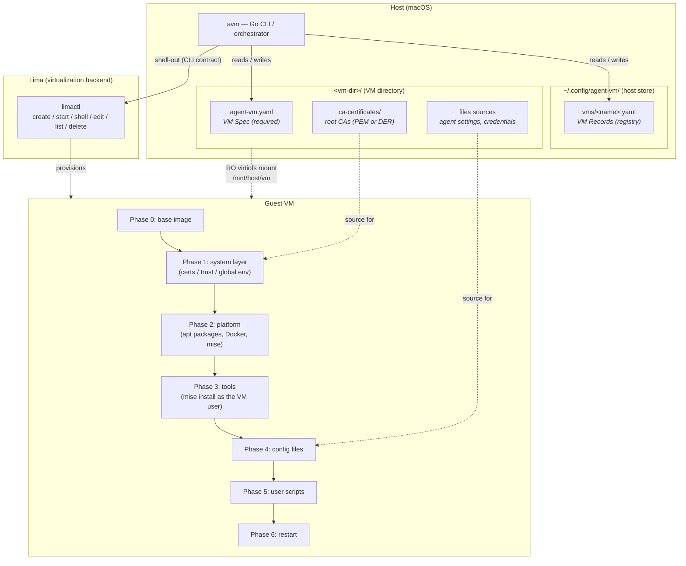
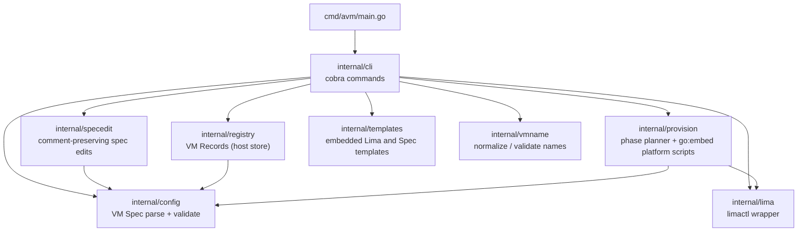
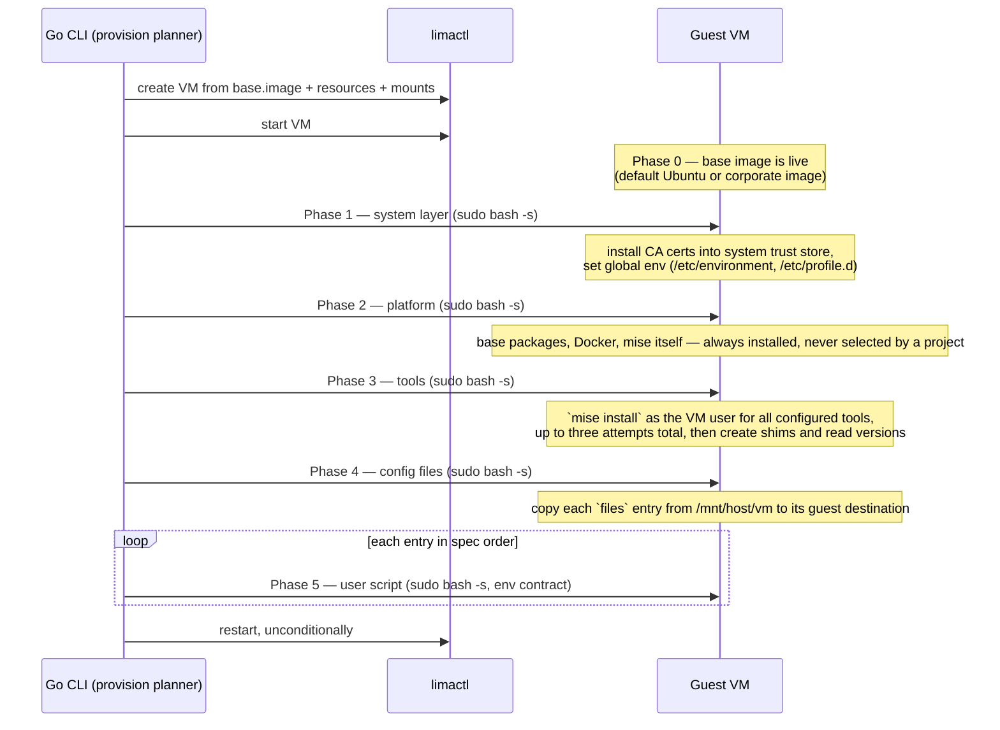
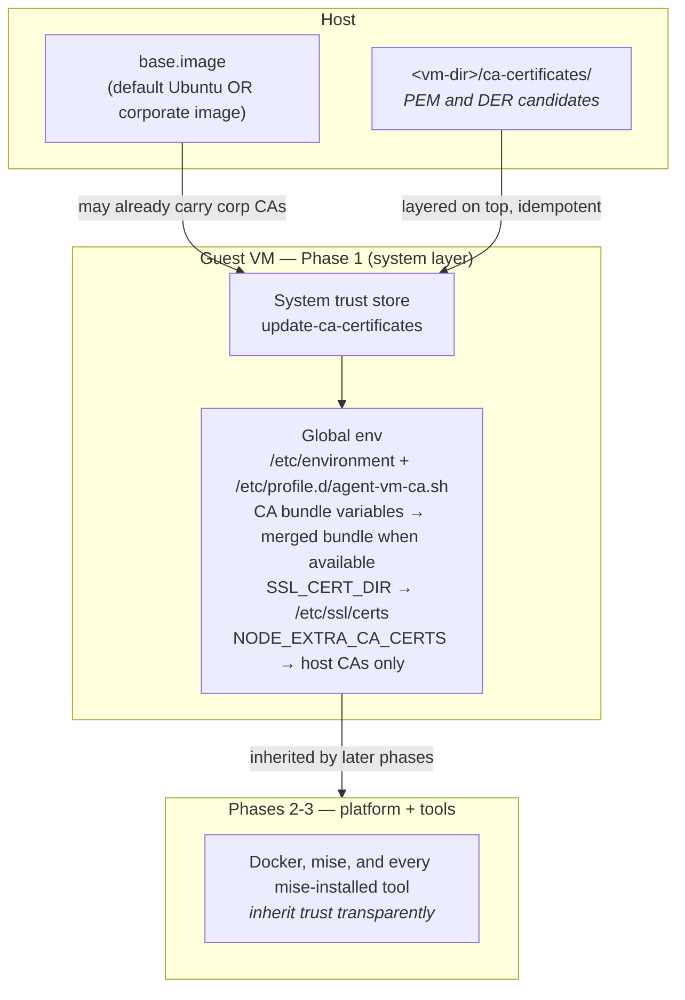
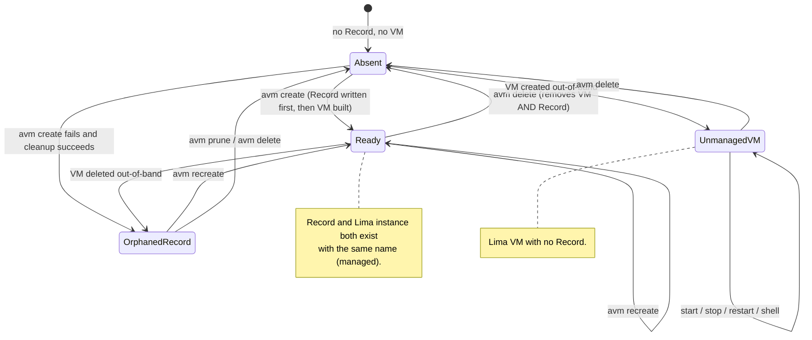

# agent-vm — Architecture

`agent-vm` provisions isolated Linux development VMs on macOS via [Lima](https://lima-vm.io/) — one VM per domain of work, described by its own folder on the host, each carrying only the tools that domain selects. The system is organized as three layers with narrow interfaces: a **Go CLI** orchestrates, **Lima** virtualizes, and **bash** provisions inside the guest.

## Design principles

- **Three clean layers.** Go orchestrates, Lima virtualizes, bash provisions. Each speaks to the next through a narrow, stable interface.
- **Modules are tool references, not scripts.** A module is a [mise](https://mise.jdx.dev/) tool name plus an optional version; installing it is one `mise install` line, not bash the project owns. Cross-cutting concerns (certificates, trust, global env, Docker, mise itself) are applied by platform phases that run *around* the tools phase, never by a module.
- **Declarative source vs realized state.** A portable, human-authored *VM Spec* expresses intent; a host-local *VM Record* is its materialization. This mirrors the manifest-vs-lockfile / Terraform config-vs-state pattern.
- **One Record per managed VM.** `avm list` matches Records to Lima instances by name and reports entries found on only one side.
- **Single self-contained binary.** Provisioning scripts and templates are embedded into the binary; the guest additionally installs a pinned mise release, so the only runtime dependency on the host stays Lima.

## 1. High-Level Architecture

Three layers plus a host-side state/config store.



**Layer boundaries:**

| Layer | Responsibility | Interface to next layer |
|-------|----------------|-------------------------|
| Go CLI | Parse config, manage the registry, plan provisioning, drive lifecycle | `limactl` subprocess calls (stable CLI contract) |
| Lima | Create/run VMs, mounts, SSH, exec | Bash executed in guest via `limactl shell ... sudo bash -s` |
| Bash provisioning | The guest scripts are the platform layer: certificates, apt packages, Docker, mise, config files, restart. Per-tool installation is delegated to mise, driven by one rendered `mise install` rather than a script per tool. | Guest env contract (see §5) |

## 2. CLI Language: Go

Go is the language of the CLI orchestrator.

| Concern | Choice | Rationale |
|---------|--------|-----------|
| Language | **Go** | Lima is itself Go; trivial cross-compilation to a single static binary; mature CLI ecosystem (cobra); `go:embed` packages provisioning scripts into the binary. |
| Lima integration | **Shell out to `limactl`**, not a library import | Lima exposes no stable public Go API; internal packages change between releases. The `limactl` CLI contract is stable. |
| Provisioning driver | **Go drives the phases** via `limactl shell <vm> sudo bash -s` (stdin), rather than Lima `provision:` blocks | Go controls ordering, per-phase status, error handling, and reconciliation; better diagnostics and rollback. |
| Module packaging | **`go:embed` for the platform provisioning scripts and the spec template**; the tools themselves are mise references resolved at provision time, not embedded per-tool scripts | A single self-contained binary for distribution; adding a new tool needs no code change, only a new entry in the Spec's `modules`. |
| Config parsing | **Native Go structs + `gopkg.in/yaml.v3`**, validation in Go | Type-safe, unit-testable validation; the only runtime dependency stays Lima. |
| CLI framework | **cobra** | De-facto standard for subcommands, flags, and help. |
| Distribution | GitHub Releases + `install.sh` (and `go install`) | Single binary; Lima is the only external dependency. The installer can install Lima through an existing Homebrew installation, but does not require a Homebrew tap for `avm`. |

### Go package structure



Dependency rule: `internal/lima` is the only package that knows about `limactl`; everything else speaks in domain types. `internal/provision` embeds its own platform scripts (`internal/provision/scripts/*.sh`) and renders the `mise install` invocation and the `files`/`scripts` phases directly from the resolved config — there is no separate module-runner package.

`internal/lima`'s `ExecRunner` filters structured Lima stderr. Normal mode shows warnings, errors, and unstructured lines such as guest provisioning output. `--verbose` includes the other structured levels. Both modes strip the structured prefix and trailing fields. The runner captures raw stderr for error messages. Interactive `avm shell` connects Lima directly to the terminal streams.

## 3. Configuration Model: VM Spec vs VM Record

The system has **two** config artifacts with distinct, non-overlapping roles. This separation is the backbone of the registry invariant.

| | `agent-vm.yaml` — **VM Spec** | `~/.config/agent-vm/vms/<name>.yaml` — **VM Record** |
|---|---|---|
| Author | human | the tool |
| Location | in the VM's own folder | host-local, never shared |
| Role | *intent* — what kind of VM this domain of work wants | *materialization* — what VM actually exists on this host |
| Contains | `name`, `modules`, `resources`, `mounts`, `files`, `scripts`, `base.image` | Resolved `modules`, `resources`, `base`, `mounts`, `files`, `scripts`, plus `name`, `createdAt`, `user`, `configDir`, `home`, and optional `installedTools` |
| Portable | **yes** — between machines where the projects live at the same paths | no — local instance state |
| Required for | `avm create`, `avm mount`, and `avm unmount` | A VM to be classified as managed |

The Spec describes the intended configuration. The Record captures the resolved configuration and stores host paths. `avm create` reads the Spec and writes the Record. `avm recreate` resolves the current Spec and attempts to update the Record after a successful rebuild. The Record supplies the target name, user, home, and VM directory.

If the recorded VM directory is empty or checking the Spec path fails, `recreate` uses the configuration stored in the Record. Errors reading, parsing, or validating a Spec found at that path abort the rebuild. The recorded VM directory still supplies the service mount and any config files, and recorded scripts must still be readable on the host. `list` matches Records to Lima instances without rereading the Spec. The registry uses `$XDG_CONFIG_HOME/agent-vm/vms` when `XDG_CONFIG_HOME` is set.

**Config resolution order (one mental model for `avm create`):**

```
flags  >  agent-vm.yaml  >  built-in defaults
```

**Transferring config between users** goes through the VM Spec, never the
Record. A colleague copies the VM folder and runs `avm create` to get an
equivalent VM, provided their projects live at the paths `mounts` names.

### Example — VM Spec (`agent-vm.yaml`)

```yaml
# Authored by a human, lives in the VM's folder.
name: work
modules:
  - node: lts
  - claude
resources:
  cpus: 4
  memory: 8GiB
  disk: 120GiB
mounts:
  - ~/projects/api
  - ~/projects/web
files:
  claude-settings.json: ~/.claude/settings.json
scripts:
  - provision/postgres.sh
```

Mount paths are absolute or `~/`-prefixed: a VM's contents must not depend on
where its folder sits. The absolute path of the folder itself is a create-time
fact and is recorded as `configDir` in the VM Record.

### Example — VM Record (`~/.config/agent-vm/vms/work.yaml`)

```yaml
# Generated by the tool. Host-local snapshot of the resolved configuration.
name: work
createdAt: 2026-06-14T12:00:00Z
user: m_doshevsky           # resolved guest Linux username
configDir: /Users/me/vms/work
home: /home/m_doshevsky.linux
base:
  image: template:_images/ubuntu
modules: [{ node: lts }, { claude: latest }]
installedTools: [{ claude: 2.1.4 }, { node: 22.9.0 }]  # what mise resolved during provisioning
resources: { cpus: 4, memory: 8GiB, disk: 120GiB }
mounts:
  - { hostPath: /Users/me/projects/api, guestPath: /home/m_doshevsky.linux/api }
  - { hostPath: /Users/me/projects/web, guestPath: /home/m_doshevsky.linux/web }
files:
  - { rel: claude-settings.json, to: /home/m_doshevsky.linux/.claude/settings.json, mode: "0644" }
scripts:
  - /Users/me/vms/work/provision/postgres.sh
```

## 4. Provisioning Model — Phases

Provisioning is a fixed sequence of phases, driven from Go. Cross-cutting concerns are isolated into their own phases that run *around* the tools phase, so a project's `modules` list drives exactly one thing: which tools `mise install` resolves.



The planner owns phase order and status. Phase 4 runs when the Spec declares files, and Phase 5 runs each declared script in order. The final restart applies changes such as Docker group membership and global environment variables.

Phase 3 writes `/etc/mise/config.toml` as root and assigns `/usr/local/share/mise`
to the VM user. Installation, shim creation, and version read-back run as that
user with the trust environment from Phase 1. A failure reading versions emits
a warning and omits `installedTools` from the new Record. The VM user can
upgrade tools in place. The system mise config sets `minimum_release_age = "0s"`,
so versions within the configured ranges are eligible as soon as mise sees them.

## 5. Guest Env Contract

The provisioning wrapper starts each phase as root, sets `DEBIAN_FRONTEND=noninteractive`, and feeds the script through stdin. Phase 3 switches to the VM user for its mise commands.

| Variable | Value | Notes |
|----------|-------|-------|
| `VM_USER` | unprivileged guest user | for `runuser`, `sudo -u`, and `usermod` |
| `VM_HOME` | the guest home | the root of every mounted project |
| `VM_CONFIG` | `/mnt/host/vm` (read-only) | the VM directory: source root for `files` entries and `ca-certificates/` |

Phase 1 owns certificate setup. The provisioning wrapper sources the generated trust environment when present, and subsequent phases inherit it. Phase 5 reads project script contents on the host and sends them to the guest over stdin.

## 6. Certificate Architecture

Two cooperating levels.



At the **image level**, `base.image` can select a pre-built corporate image with its own trust configuration. At the **provision level**, Phase 1 reads CA files from the VM directory. When it accepts files, it updates the system store and writes trust variables to `/etc/profile.d/agent-vm-ca.sh` for login shells and `/etc/environment` for sessions that use PAM.

- **Candidate files.** Phase 1 skips hidden files and files ending in `.md`.
  It extracts PEM blocks by their markers or converts DER to PEM. It reports
  accepted and rejected candidates on stderr, with one count per input file.
  If every candidate is rejected, the phase fails. A directory with no
  candidates needs no custom trust configuration.
- **Trust paths.** `SSL_CERT_FILE`, `REQUESTS_CA_BUNDLE`, `GIT_SSL_CAINFO`, and
  `CURL_CA_BUNDLE` usually point to the merged system bundle rebuilt by
  `update-ca-certificates`. The implementation uses the host-CA bundle when the
  system bundle is absent or empty. `SSL_CERT_DIR` points to `/etc/ssl/certs`.
  Node adds the host-only bundle from `NODE_EXTRA_CA_CERTS` to its built-in roots.
- **Provisioning inheritance.** The non-login provisioning wrapper sources
  `/etc/profile.d/agent-vm-ca.sh` when readable. This supplies trust settings
  independently of PAM. Phase 3 carries them through `runuser` to mise.

When `curl` is installed, Phase 1 tries HTTPS requests to `github.com` and
`api.github.com`. A failed request prints a warning and provisioning continues.
The checks cover these two addresses. Tool backends can contact additional hosts.

## 7. VM Registry & Lifecycle

The registry holds one Record per managed VM under `~/.config/agent-vm/vms/` by default. Lima supplies the current instance names and runtime states. Records supply the most recently stored configuration and create-time facts.

`avm list` and `avm prune` match Lima instances and Records by name. A name in both is **managed**, a Record alone is **orphaned**, and a Lima instance alone is **unmanaged**. This check covers existence. The detailed view shows the recorded configuration, including mounts and the tools resolved during provisioning. `prune` deletes orphaned Records.

`avm create` refuses a name with an existing Record. It writes a new Record before creating the Lima instance. On failure it attempts `limactl delete -f` and keeps the Record. This cleanup also runs when Lima rejects creation because the name already exists, so a name collision with an unmanaged instance can delete that instance.



The lifecycle commands and `avm delete <name>` can target an unmanaged VM. `delete` attempts to stop the instance, deletes it through Lima, then removes any corresponding Record. If the Lima deletion returns an error, the Record is kept.

`avm recreate <name>` requires a Record. It reports the configuration source described in §3 and rebuilds the guest from scratch. This discards guest-only files, tool state, and Docker volumes. The rebuilt VM uses the host mounts from the resolved configuration. The original Record remains if the rebuild fails.

## 8. Mounts

Every entry in `mounts` is equal: there is no main project and no privileged
mount. Each host folder is virtiofs-mounted read/write at `~/<name>` in the
guest, where `name` defaults to the folder's basename and can be overridden per
entry when two projects share one. The generated Lima config mounts the VM's
own directory **read-only** as a service mount at `/mnt/host/vm`. It marks
project mounts read/write.

Git division of labor: commit/diff/branch in the VM; push/pull on the host where
credentials live.

**Runtime changes.** `avm mount` and `avm unmount` attach and detach projects
without rebuilding the VM. Each first edits the Spec through `yaml.Node` to
preserve comments, saves the updated Record, and then attempts synchronization
with Lima. A failure after an earlier write can leave the artifacts out of sync.

Synchronization renders the complete list from the Record and applies it via
`limactl edit --set '.mounts = […]'`. A hand-edited Spec is picked up by
`avm recreate`.

Lima attaches virtiofs devices at boot. `avm` queries the instance's state to
decide when to edit its configuration.

- **VM absent.** Save the changes in the Spec and Record for a later rebuild.
- **VM stopped.** Edit the Lima config directly. The new list is attached on
  the next start.
- **VM running.** Ask for confirmation before `stop → edit → start`. Declining
  saves the changes in the Spec and Record only. An ordinary `avm restart` uses
  the existing Lima config. The same mount or unmount command exits before
  synchronization on a repeat invocation. The CLI explains that
  `avm recreate <name>` rebuilds from the updated Spec and discards guest-only
  state.

## 9. Command Surface

| Command | Behavior |
|---------|----------|
| `avm init [path]` | Write an `agent-vm.yaml` VM Spec template. |
| `avm create [path]` | Create + provision the VM from a VM directory's Spec; write Record + create VM. |
| `avm recreate <name>` | Rebuild from the Spec, with a Record fallback for configuration as described in §3. |
| `avm list [name]` | List all entries with registry status and Lima runtime state. With a name, show that VM's recorded mounts and tools. |
| `avm mount <vm> [path]` | Attach a project folder to a VM. See §8 for synchronization. |
| `avm unmount <vm> <path\|name>` | Detach a project folder. |
| `avm shell [name]` | Open a shell and pass the recorded guest home to `limactl shell --workdir` when available. Lima selects the working directory otherwise. |
| `avm start / stop / restart [name]` | Lifecycle controls. |
| `avm delete <name>` | Stop + delete the VM **and** remove its Record. |
| `avm prune [name]` | Remove a named orphaned Record, or all orphaned Records when the name is omitted. |

### Target resolution

`shell`, `start`, `stop`, and `restart` use the following order.

```
1. explicit name argument           e.g. `avm shell work`
2. else agent-vm.yaml in cwd        e.g. `avm shell`  (name from `name:`, else dir basename)
3. else error
```

`mount`, `unmount`, `delete`, and `recreate` require a VM name. `list` and
`prune` operate across entries when the name is omitted. The optional argument
to `init` and `create` is a directory path.

### Flags

Resource flags are `--cpus`, `--memory`, `--disk`. `--modules=…` takes mise tool
references, e.g. `--modules=node@lts,go@1.24`. `--base-image=…` overrides the
default base image. `avm mount --name <name>` sets the guest directory name when
two projects would otherwise collide.

With no `--modules` flag and no `modules` key, the defaults are `node@lts` and
`claude@latest`. An explicit empty list selects only the platform packages.
`avm init` generates a Spec that selects Node LTS, Claude, and Codex.

## 10. Repository Layout

```
cmd/avm/main.go             entrypoint
internal/
  cli/                      cobra commands (incl. mount.go, mountsync.go)
  config/                   VM Spec schema + validation
  specedit/                 comment-preserving edits to agent-vm.yaml
  registry/                 VM Records (host store) + reconciliation
  lima/                     limactl wrapper (only limactl-aware package)
  provision/                phase planner + go:embed platform scripts
  templates/                embedded Lima and VM Spec templates
  vmname/                   name normalization / validation
internal/provision/scripts/*.sh   platform provisioning scripts (go:embed'd into internal/provision)
internal/templates/files/*        Lima base template + agent-vm.yaml spec template
```

The platform provisioning scripts and both templates are embedded into the binary, so `avm` ships as a single file. Per-tool installation needs no code or embedded script of its own — it is a `modules` entry that mise resolves at provision time.

## 11. Non-goals

The architecture deliberately does not include: building derived/baked images
from within the tool (`base.image` consumes an already-prepared image instead);
re-applying modules to a running VM without recreating it (the model is "change
config → `avm recreate`"); hot-attaching a mount without a restart (Lima
attaches virtiofs devices at boot); importing externally-created VMs into the
registry; and non-macOS hosts (Lima/virtiofs assumptions hold).

## 12. Key Decisions

| # | Decision |
|---|----------|
| D1 | CLI language is Go. |
| D2 | Integrate Lima by shelling out to `limactl`, not as a library. |
| D3 | Go drives provisioning phases; bash is the in-guest provisioning language. |
| D4 | Platform provisioning scripts and templates embedded via `go:embed`; per-tool installation delegated to mise, so a new tool needs no code change. |
| D5 | Config parsed natively in Go; Lima is the only runtime dependency. |
| D6 | Certificates handled by a Phase 1 system layer + global env; modules are unaware. |
| D7 | Support a corporate `base.image`; the tool does not build images. |
| D8 | Two-artifact config model: portable VM Spec vs host-local VM Record. |
| D9 | Host-local Records matched to Lima instances by name for listing and pruning. |
| D10 | `avm create` resolves flags, Spec, and defaults in that order. Shell and lifecycle verbs share target resolution. |
| D11 | Mount synchronization rewrites the full list from the Record. Running VMs require confirmation for `stop → edit → start`. |
